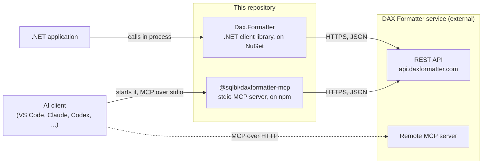
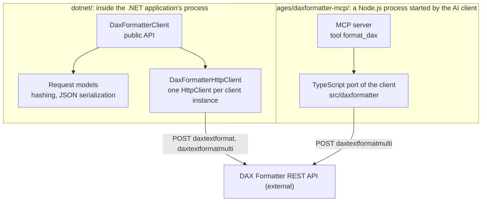

# Architecture

## Context

DAX Formatter is a service that formats DAX expressions and reports their syntax errors. This repository holds two client packages that call it: a .NET client library that applications embed, and an MCP server that AI clients start on the user's machine. The service, its REST API and its remote MCP server are maintained outside this repository and are treated here as an external system, known only through its public endpoints ([REST API](rest-api.md)).

- A .NET developer adds `Dax.Formatter` to an application, which formats DAX through the REST API.
- A user of an AI client adds the stdio MCP server, which the client starts with `npx` and which formats DAX through the same REST API.
- The same user can instead connect the AI client to the remote MCP server hosted by the service, with nothing to run locally. How to connect each client to either server is documented only on SQLBI Docs: [remote](https://docs.sqlbi.com/dax-formatter/mcp-http), [stdio](https://docs.sqlbi.com/dax-formatter/mcp-stdio).

## Building blocks

Each package lives in its language folder and builds with its own toolchain ([ADR-0001](../decisions/0001-organize-the-repository-by-language.md)).

- `Dax.Formatter` targets `netstandard2.0`, `net8.0` and `net10.0`. `DaxFormatterClient` formats one expression or many in one call; each instance keeps one `HttpClient` for its lifetime, so reusing an instance reuses its connections. One solution holds the library and its tests; samples build against the published package ([ADR-0003](../decisions/0003-keep-one-net-solution-with-role-folders.md)).
- `@sqlbi/daxformatter-mcp` is an MCP server over stdio, built on the MCP TypeScript SDK, with one read-only tool, `format_dax`, whose input and output are validated with zod. It carries its own TypeScript port of the client, which is not published on its own (see the [backlog](../backlog.md)).
- The REST contract is implemented twice, once per client; [`rest-api.md`](rest-api.md) is its only description, and the [backlog](../backlog.md#known-debt) records where the two implementations differ.

## Key flows

Formatting from a .NET application:

1. The application creates a `DaxFormatterClient`, which sets the [caller identity](rest-api.md#caller-identity) of every request.
2. It calls `FormatAsync` with one expression, a list, or a request object that also carries formatting options and the model's metadata.
3. The client posts the request as JSON to the single or the multiple endpoint and deserializes the result.

Formatting from an AI client through the stdio server:

1. The AI client starts `npx -y @sqlbi/daxformatter-mcp` and initializes the MCP session, which tells the server the client's name and version.
2. The model calls `format_dax` with every expression in one array.
3. The server sends one request to the multiple endpoint, with a caller identity that includes the client's name and version, and returns one result per expression, as structured content and as text.

## Cross-cutting concerns

- Privacy: the DAX text goes to the service, where the formatting happens. Server and database names are hashed by the client before they leave it ([hashing](rest-api.md#hashing-of-server-and-database-names)).
- Caller identity: each request names the calling application and its version, for usage statistics ([caller identity](rest-api.md#caller-identity)).
- Errors: DAX syntax errors are normal results; only transport failures, timeouts and non-success HTTP statuses are errors ([errors](rest-api.md#errors)).
- Tests: the .NET tests call the live service, while the MCP tests replace `fetch` and run offline ([backlog](../backlog.md#known-debt)).

## Versions and releases

Each package has its own version, tags and release workflow ([ADR-0004](../decisions/0004-version-tag-and-release-each-package-independently.md)). Nerdbank.GitVersioning (NBGV) computes the version from the package's `version.json`: the version height counts the commits that touch the file's path filters, and a build of `master` gets a version without the commit suffix. How to release is in the [release guide](../guides/release.md).

| | `Dax.Formatter` | `@sqlbi/daxformatter-mcp` |
|---|---|---|
| Version file | `dotnet/version.json`, path filter `./src/Dax.Formatter` | `typescript/packages/daxformatter-mcp/version.json`, path filter `.`: any change in the package folder, its README included, raises the version |
| Stamped by | the `Nerdbank.GitVersioning` MSBuild package, referenced by `dotnet/Directory.Build.props` | the `nerdbank-gitversioning` npm package: `nbgv-setversion` writes the version into `package.json` at release; the committed `package.json` holds a placeholder |
| CI | `dotnet-ci.yml` | `typescript-ci.yml` |
| Release | `dotnet-release-dax-formatter.yml`, to nuget.org with Trusted Publishing; the assembly is strong-named with a key that the workflow writes from a secret | `typescript-release-daxformatter-mcp.yml`, to npm with provenance |

Both release workflows read the version from the same NBGV copy that stamps the package, run only from `master`, and create a draft GitHub release.

`dotnet/version.json` must never have the same content as the root `version.json` of the commits before the move ([ADR-0001](../decisions/0001-organize-the-repository-by-language.md)), whose path filter was `src/Dax.Formatter`. While the two files are identical, NBGV resolves the relative path filter from the old root location, so commits under `dotnet/src/Dax.Formatter` don't raise the version height and the computed version is 1.2.2, already published on nuget.org (seen with the nbgv CLI 3.7.112, 3.9.50 and 3.10.94 and the `Nerdbank.GitVersioning` 3.9.50 MSBuild task). Once the content differs, the filter resolves under `dotnet/` and the height continues from the 1.2 history. Hence the filter is written `./src/Dax.Formatter`: written as `src/Dax.Formatter`, it would make the files identical again.
